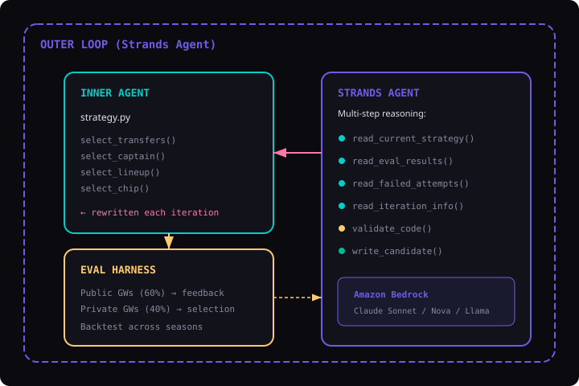

# Twelve weeks of a self-improving agent on Amazon Bedrock: what worked, what broke, and five models compared

*All numbers come from the project's own logs, DynamoDB state, CloudWatch and Cost Explorer.*

## TL;DR

- I built a loop where an agent on Amazon Bedrock rewrites its own Fantasy Premier League (FPL) strategy code, backtests each rewrite on gameweeks it hasn't seen, and keeps only rewrites that score higher. It has started on schedule every Tuesday since mid-September.
- The backtest score rose from 52.75 to a peak of 56.48 points per gameweek. My real team finished below the average manager in 5 of the 8 gameweeks I tracked, 41 points behind the average in total.
- For six weeks the loop reported gains of 17 to 22% while the deployed strategy wasn't improving. Two bugs in how I measured the baseline and picked the starting strategy caused it.
- The fix for those bugs didn't reach production either. The build step that updates the agent's container has failed every week since at least September, and the build has reported success every time.
- In a controlled comparison from the same starting strategy, Claude Opus 5 kept the most improvements (3 of 5 attempts). GPT-6 Astra was the fastest and used about a third of the output tokens, but none of its 5 attempts improved and 4 lost 4.5 to 5 points. Five attempts per model is a small sample. The whole comparison cost about $23.
- Running third-party models inside a tool-using agent needed several fixes: leaving out the temperature field, stripping Grok's reasoning blocks from the conversation history, a larger output budget for Grok, and a Marketplace subscription that blocked GPT-6.2 Astra entirely.

## Why Fantasy Premier League

AIDE² from Weco AI showed an agent improving its own ML research code. I wanted a cheaper place to try the same idea, where every decision is code, the whole history can be replayed, and nothing breaks when the agent is wrong. FPL fits. Each week you pick transfers, a captain whose points count double, a starting eleven and occasionally a chip, under a budget and squad rules. Ten seasons of player-by-gameweek data are public.

## The system

- **The strategy (inner agent).** A Python file of about 25 to 30 KB that decides transfers, captain, lineup and chips each gameweek. This is the file the loop rewrites.
- **The backtest.** It replays the 2024-25 and 2025-26 seasons plus the current season so far. Gameweeks are split 60/40: the agent sees scores for the first group, and keep-or-reject decisions use only the held-out second group.
- **The proposer.** A [Strands Agents](https://strandsagents.com) agent with six tools: read the strategy, read the latest scores, read failed attempts, read iteration info, validate code, and submit a candidate. It works through them in order and submits one complete rewritten strategy per call.
- **The runtime.** One iteration per invocation on Amazon Bedrock AgentCore Runtime. EventBridge triggers a Lambda orchestrator every five minutes, and state lives in DynamoDB.
- **The weekly pipeline.** Every Tuesday CodeBuild builds and pushes a new container image and starts a 50-iteration run. Claude Sonnet 5 handles iterations 1 to 40 and Claude Opus 5 handles 41 to 50, stopping early if Opus finds an improvement. (The step meant to point the runtime at the new image has been failing; see "A build that reported success for eleven weeks" below.)
- **Delivery.** When a run completes, the best strategy is copied into a Telegram bot and REST API on Lambda.
- **The validation ledger.** Every Monday a Lambda records my real score, the gameweek average and what the top 1,000 managers captained.

A weekly run takes about five hours. Cost Explorer shows about $35 to $40 of Claude usage per run, including some development testing. My early estimate of $12 per run was off by about three times. AgentCore Runtime itself costs about $2 a month.

## The numbers that looked good

| Run date | Best backtest score (points per gameweek) |
|---|---|
| Sep 9 | 52.75 |
| Sep 15 | 53.25 |
| Sep 22 | 54.41 |
| Sep 29 | 56.00 |
| Oct 6 | 56.28 |
| Oct 13 | 56.48 |
| Oct 20 | 55.03 |
| Oct 27 | 54.87 |
| Nov 3 | 55.70 |
| Nov 10 | 54.35 |
| Nov 17 | 54.32 |
| Nov 24 | 54.65 |

Each run also reported its own gain over its starting point, usually 17 to 22%. Most of that number was wrong, as the next section explains.

## Six things that broke, and what each one taught me

**1. A container built for the wrong CPU.** AgentCore Runtime accepts only arm64 images. My CodeBuild job built amd64. `UpdateAgentRuntime` rejected each new image with "Architecture incompatible", but the build step didn't check the result, so the runtime stayed on an old, broken version for three weeks. Every invocation failed, and two weekly runs scored zero while the pipeline reported success. I rebuilt the image for arm64 and updated the runtime by hand, then changed the build to use buildx, tag every image uniquely, and fail if the runtime doesn't reach `READY`. That last check has never run, for the reason in item 6.

**2. A strategy that outgrew the output limit.** Once the strategy passed about 26 KB, a 16,000-token output limit left the proposer unable to write a complete rewrite. Every call was cut off mid-file and produced no candidate. In one 50-iteration run, 48 iterations recorded exactly the starting score. Raising the limit to 32,000 tokens fixed it. The broader lesson is to log how many candidates each run produces, not only the best score.

**3. Measuring improvement against the wrong baseline.** This bug has been in the code since the start, and it's still in the running container. The loop scored its baseline using the repository's default strategy (46.29) instead of the strategy it was trying to improve (about 54). Any rewrite of a 54-point strategy cleared a 46-point bar, so every run kept its first candidate at iteration 1 or 2 and reported a gain of about 8 points. That first candidate could be worse than the strategy it replaced. Later improvements within a run were compared correctly against the run's current best, and that's where the real September gains came from.

A second bug made it worse. Each new run started from the completed run with the highest recorded score. Scores are measured on different data each week as the current season grows, so they aren't comparable across runs. The selection got stuck on the October 13 peak: every run from October 20 to November 17 restarted from that same strategy. Scored on identical data, the strategies deployed on November 3, 10 and 17 went 55.23, 54.35, 54.32.

The fix scores the starting strategy through the same code path as candidates, starts each run from the most recent completed run, and refuses to deploy a run that didn't beat its starting strategy.

The first run after the fix, on November 24, showed it only half landed. The seeding change lives in the orchestrator Lambda, which I deploy directly, and it worked: the run started from the previous week's strategy, not the October 13 one. The baseline change lives in the agent's container, and the container wasn't updated (item 6). The run's baseline was 46.39 again, iteration 1 kept a 51.16 strategy that was worse than the 54.29 it started from, and the run then worked its way back up. Scored on identical data, the strategy it deployed (54.23) is no better than the one it replaced (54.29). The deploy guard let it through because it compares against the run's recorded baseline, which was the wrong number.

**4. A data source that blocks cloud IPs.** The FPL API returned 403 to Lambda. Browser-like request headers fixed the public endpoints, which carry player data and league standings. The per-user team endpoints still return 403 from AWS IP ranges regardless of headers. The weekly ledger works. The bot's per-user recommendations need a residential proxy, which I haven't set up, so today the bot can't fetch a user's team from Lambda.

**5. A race in the deploy trigger.** The job that deploys a finished strategy fired as soon as any completed run existed in DynamoDB. That was always true, so it shipped the previous week's strategy hours before the current run finished. It now waits for one specific run ID.

**6. A build that reported success for eleven weeks.** The buildspec calls Python inline with `python -c "..."` inside a YAML block. YAML keeps the block's indentation, so the Python arrives with leading spaces and fails with `IndentationError: unexpected indent`. That broke three steps every week: updating the AgentCore runtime to the new image, clearing stale run state, and updating the orchestrator's environment (that one failed separately, because the CLI's shorthand syntax parsed a JSON list as a list). None of these failures stopped the build. CodeBuild runs a multi-line block as one command, and the exit code is the last command's, which succeeded. So each week the pipeline pushed a new image, logged an error nobody read, and kept running the September 9 image. Every improvement I made to the agent's code after September 9 reached the repository and the container registry, but not the runtime.

## Backtest score versus real results

The validation ledger shows the gap:

| Gameweek | My points | Average manager | Difference |
|---|---|---|---|
| 4 | 62 | 69 | -7 |
| 5 | 38 | 48 | -10 |
| 6 | 59 | 58 | +1 |
| 7 | 47 | 59 | -12 |
| 8 | 24 | 45 | -21 |
| 9 | 52 | 47 | +5 |
| 10 | 62 | 55 | +7 |
| 11 | 31 | 35 | -4 |
| **Total** | | | **-41** |

My overall rank is about 9.1 million of 11.3 million managers. My team isn't a clean test of the strategy, because I overrode some recommendations and made my own transfers, but the direction matches what the backtest data shows.

The strategy scores about 55 on the combined backtest but 40.67 on the current season alone, measured at the end of October with eight gameweeks of current data. The loop's weekly improvements didn't change that 40.67 at all. The backtest has 76 gameweeks from previous seasons and only a handful from this one, so the loop was mostly optimizing for how football was played in previous seasons.

Captaincy is the clearest example. The top managers converge on one captain: in several gameweeks, 90 to 99% of the top 200 captained Erling Haaland. I reconstructed the strategy's captain choice for gameweeks 4 to 10 using only information available before each deadline. It averaged 5.0 points per gameweek before doubling. The top managers' consensus pick averaged 7.0. Seven gameweeks is a small sample, but it lines up with the live gap.

My own measurement had a flaw too. The ledger's "strategy shadow" figure ran on Mondays using player form that already included the gameweek being scored, and it reported 13.3 points per gameweek for the strategy's captain. The reconstruction above uses only data from before each deadline, and it's the number I trust.

I've added an override that recommends the top managers' consensus captain when the user owns that player. It isn't reaching users yet because of the 403 problem above. The next step is to change what the loop optimizes for, so it learns from what top managers do this season rather than from historical points.

## Five models from the same starting point

I wanted to know whether the choice of model matters for this kind of loop, so I ran a controlled comparison on November 22.

**Method.** Every model started from the same strategy (the one currently deployed, scoring 54.32 on held-out gameweeks), with the same data, the same 60/40 split and the production keep threshold of +0.1. Each model made five independent attempts, all from the same starting strategy, so attempts don't build on each other. I recorded wall-clock time and output tokens from the Strands agent's usage metrics. All calls went through US cross-region inference profiles. The harness is `scripts/compare_models.py`.

| Model | Attempts | Candidates scored | Improved | Best change | Median change | Avg time per attempt | Avg output tokens | Cost on the day | Failures |
|---|---|---|---|---|---|---|---|---|---|
| Claude Opus 5 | 5 | 5 | 3 | +1.94 | +0.13 | 7.6 min | 47,800 | $10.51 | none |
| Claude Sonnet 5 | 5 | 1 | 1 | +0.94 | +0.94 | 4.4 min | 45,500 | $1.81 | 1 output limit, 3 service unavailable |
| GPT-6 Astra | 5 | 5 | 0 | 0.00 | -4.55 | 3.0 min | 15,600 | $6.06 | none |
| Grok 4.6 | 5 | 5 | 1 | +0.58 | -0.45 | 4.1 min | 38,500 | $1.77 | none |
| Grok 4.7 | 5 | 4 | 0 | -0.03 | -0.90 | 9.0 min | 57,100 | $2.67 | 1 service unavailable |
| GPT-6.2 Astra | 5 | 0 | 0 | | | | | | blocked (see below) |

Costs are each model's full Cost Explorer line for November 22. The Grok figures include about ten earlier attempts that failed before the fixes below and one test call, and Sonnet's includes its four failed attempts.

What I took from it:

- **Claude Opus 5** kept improvements on three of five attempts. The best raised the strategy's captaincy points across the backtest from 458 to 470. It was also the slowest of the models that completed every attempt, produced the most output, and cost the most, at about $2.10 per attempt.
- **Claude Sonnet 5** completed only one of five attempts in this window. One hit the 32,000-token output limit and three got `serviceUnavailableException` from Bedrock. The one that finished improved by 0.94. Sonnet has produced most of the kept improvements in the weekly pipeline, so I read this as a capacity problem on the day, not a quality signal.
- **GPT-6 Astra** was the fastest and used about a third of the output tokens of the Claude models. None of its attempts improved, and four lost 4.5 to 5 points. Captaincy points fell from 458 to between 438 and 448, and transfer penalties stayed at zero, so the losses came from other strategy changes. It cost $6.06, more than Grok 4.6 and 4.7 together, even though it reported the fewest output tokens. In a single-attempt test in September on a smaller strategy, Astra was close to neutral (-0.14) and Opus did worse (-1.11), so one comparison on one task shouldn't decide anything.
- **Grok 4.6** completed every attempt once the fixes below were in place, with one improvement of 0.58, and was the cheapest per attempt.
- **Grok 4.7** was the slowest, at about 9 minutes per attempt, and produced the most output. None of its four scored candidates improved, and one attempt failed with a service-unavailable error.

Treat this table as an anecdote, not a benchmark. It's one starting strategy, one task and five attempts per model. Apart from Astra's consistent losses, most changes fall within about two points either way.

## What it took to run third-party models in a tool-using agent

None of these show up in a single test prompt. They appear once an agent makes several calls in a row with tools.

- **Temperature.** Claude Sonnet 5, Claude Opus 5, GPT-6 Astra and both Grok models reject the `temperature` field with a `ValidationException`. Leave it unset.
- **Reasoning blocks in history.** Grok returns a `reasoningContent` block, then rejects that same block when it appears in an assistant message in the next request. A tool-using agent resends the conversation after every tool call, so every Grok run failed on its second turn. A small `BedrockModel` subclass that strips reasoning blocks from outgoing history fixed it.
- **Output budget.** Grok's reasoning tokens come out of the same output budget as its answer. With 32,000 tokens, a full rewrite of a 30 KB file ran out after nine minutes. 64,000 worked, and Bedrock accepted up to 128,000.
- **Marketplace subscription.** GPT-6.2 Astra never ran. Bedrock returned `AccessDeniedException` with `INVALID_PAYMENT_INSTRUMENT`: the AWS Marketplace subscription for the model needs a payment method on file before it activates, even on an account that pays with credits. GPT-6 Astra worked, and its usage was covered by credits.
- **Capacity.** In a two-hour window, CloudWatch recorded server errors on 3 Claude Sonnet 5 calls and 5 Grok 4.7 calls. Retry with backoff, and count failed calls separately from bad candidates so they don't skew a comparison.
- **Comparing cost.** Token counts from the API don't line up with the bill. CloudWatch showed 4,620 input tokens across 35 GPT-6 Astra calls, because prompt caching is reported differently per provider, and Astra's $6.06 is far more than its reported output tokens would explain. Compare dollars from Cost Explorer. On this account, Claude and GPT-6 Astra bill through AWS Marketplace under their own service names. Grok bills under the plain "Amazon Bedrock" service, with per-model usage types such as `xai.grok-4.7-mantle-output-tokens-standard`, so it's easy to miss if you filter by model name.

## What I'd tell someone building this

- **Use the same baseline.** Measure every candidate against the thing it would replace, on the same data, through the same code path. If the baseline is wrong, a self-improvement loop reports steady gains indefinitely.
- **Count the failures.** Track how many candidates each run produces and why the rest failed. My two worst weeks reported success.
- **Don't trust only the backtest.** Treat it as a proxy, keep a live record of real results, and check that record for look-ahead. Mine had some.
- **Fail loudly on infrastructure, and check what's actually running.** A deploy step that can't update the runtime should fail the build, not log a line and carry on. A green build told me nothing for eleven weeks. Checking the runtime's version and image tag would have caught it on the first Tuesday.
- **Fix the harness first.** The largest score swings in this project came from bugs in the harness, not from switching models.

## Reproduce it

[TODO: repo link and whether it's public.] The comparison harness is `scripts/compare_models.py` and `scripts/summarize_comparison.py`. The weekly pipeline is `buildspec.yml` plus `deploy/orchestrator.py` and `deploy/full_loop.py`.
